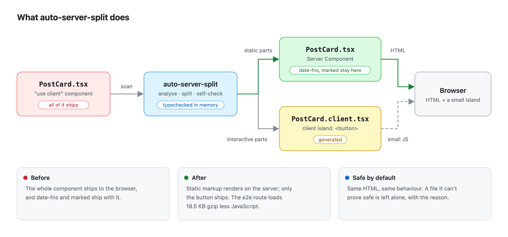
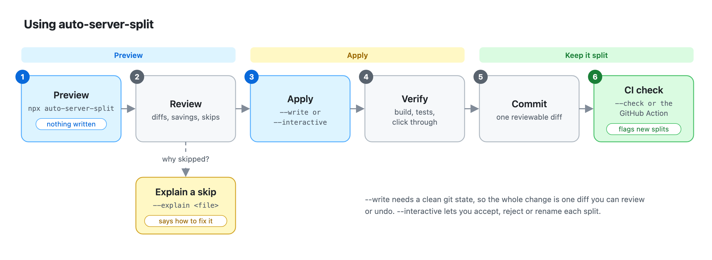

# auto-server-split

[](https://www.npmjs.com/package/auto-server-split)
[](https://github.com/HimeshGunathilaka/auto-server-split/actions/workflows/ci.yml)
[](LICENSE)

**Ship less JavaScript from your Next.js app without refactoring by hand.** auto-server-split finds
`"use client"` components that are mostly static and splits each one into a Server Component plus a
small client island for the parts that are actually interactive.

<p align="center">
  <picture>
    <source media="(prefers-color-scheme: dark)" srcset="docs/images/what-it-does-dark.png">
    
  </picture>
</p>

## Why use it

- **Smaller bundles.** Static markup renders on the server, and libraries it needed (date-fns,
  marked…) stop shipping to the browser. One route in the e2e app loads 18.5 KB gzip less.
- **Same page, same behaviour.** The rendered HTML and every interaction stay identical; the e2e
  suite checks this on sample apps after every change to the tool.
- **Safe by default.** Every rewrite is typechecked and re-analysed before it's written. When the
  tool can't prove a split is safe, it leaves the file alone and tells you why.
- **Fits your workflow.** A CLI codemod, an ESLint rule, a GitHub Action and a programmatic API,
  all on the same engine. Changes are plain source code you review like any other diff.

## Example

```tsx
// PostCard.tsx (before): everything ships to the browser
"use client";
import { format } from "date-fns";
import { marked } from "marked";
import { useState } from "react";

type Post = { title: string; date: string; body: string };

export default function PostCard({ post }: { post: Post }) {
  const [liked, setLiked] = useState(false);
  return (
    <article>
      <h2>{post.title}</h2>
      <time>{format(new Date(post.date), "PPP")}</time>
      <div dangerouslySetInnerHTML={{ __html: marked(post.body) as string }} />
      <button onClick={() => setLiked(!liked)}>{liked ? "♥" : "♡"}</button>
    </article>
  );
}
```

```tsx
// PostCard.tsx (after): a Server Component; date-fns and marked no longer ship to the browser
import { format } from "date-fns";
import { marked } from "marked";
import { PostCardButton } from "./PostCard.client";

type Post = { title: string; date: string; body: string };

export default function PostCard({ post }: { post: Post }) {
  return (
    <article>
      <h2>{post.title}</h2>
      <time>{format(new Date(post.date), "PPP")}</time>
      <div dangerouslySetInnerHTML={{ __html: marked(post.body) as string }} />
      <PostCardButton />
    </article>
  );
}
```

```tsx
// PostCard.client.tsx (generated): only the interactive part
"use client";
import { useState } from "react";

export function PostCardButton() {
  const [liked, setLiked] = useState(false);
  return <button onClick={() => setLiked(!liked)}>{liked ? "♥" : "♡"}</button>;
}
```

## Quick start

Requires Node.js 20+, a Next.js App Router project and git.

```bash
npm install --save-dev auto-server-split

npx auto-server-split components          # preview: diffs and estimated savings, nothing is written
npx auto-server-split components --write  # apply (from a clean git state)
```

Then review the diff, run your build and tests, and click through the affected pages.

<p align="center">
  <picture>
    <source media="(prefers-color-scheme: dark)" srcset="docs/images/workflow-dark.png">
    
  </picture>
</p>

## Common commands

| Command                                                 | What it does                                                     |
| ------------------------------------------------------- | ---------------------------------------------------------------- |
| `npx auto-server-split [paths]`                         | Preview the splits and the estimated saving (nothing is written) |
| `npx auto-server-split --write`                         | Apply every split                                                |
| `npx auto-server-split --interactive`                   | Accept, reject or rename each split                              |
| `npx auto-server-split --explain <file>`                | Explain why a file was split or skipped, and how to fix a skip   |
| `npx auto-server-split --remove-unused-directives`      | Also remove `"use client"` where nothing needs it                |
| `npx auto-server-split --check`                         | For CI: exit `2` when a split is available                       |
| `npx auto-server-split --format html --output out.html` | A shareable report (also `json`, `markdown`, `sarif`, `gitlab`)  |
| `npx auto-server-split --workspace`                     | Run on every Next.js app in a monorepo                           |
| `npx auto-server-split verify`                          | Run your configured typecheck, tests and build                   |

Every flag, exit code and monorepo option is in the [CLI reference](docs/cli.md).

## CI

```yaml
# .github/workflows/auto-split.yml
on: pull_request
jobs:
  auto-split:
    runs-on: ubuntu-latest
    steps:
      - uses: actions/checkout@v4
        with:
          fetch-depth: 0
      - uses: actions/setup-node@v4
      - run: npm ci
      - uses: HimeshGunathilaka/auto-server-split@v1.0.3
        with:
          since: origin/${{ github.base_ref }} # only the files the pull request changes
```

Available splits show up as annotations on the pull request. To adopt it in an existing app, record
today's opportunities in a baseline so only new ones fail. See [CI](docs/ci.md) for baselines,
budgets, SARIF and GitLab reports.

## ESLint

```js
// eslint.config.js
import tseslint from "typescript-eslint";
import autoSplit from "auto-server-split/eslint";

export default [...tseslint.configs.recommended, autoSplit.configs.recommended];
```

The rule flags splittable components in your editor, with the command that applies the split. See
[docs/eslint.md](docs/eslint.md).

## Configuration

Optional. Create `auto-split.config.ts` in the project root:

```ts
import { defineConfig } from "auto-server-split";

export default defineConfig({
  include: ["app/**", "components/**", "src/**"],
  minBytesSaved: 2048, // skip splits that save less (gzip bytes)
  removeUnusedDirectives: true,
});
```

To leave a file alone, add `// auto-server-split-ignore: <reason>` to its `"use client"` line. Every
option is in [docs/configuration.md](docs/configuration.md).

## API

```ts
import { split } from "auto-server-split";

const result = await split({ root: process.cwd(), paths: ["app", "components"], write: false });
console.log(result.summary.changes, result.summary.bytesSaved);
```

See [docs/api.md](docs/api.md).

## Good to know

- **It's conservative.** Components that are interactive throughout stay as they are. The tool
  helps most where `"use client"` sits high in the tree.
- **Check the warnings.** Code that moves to the server runs in the server's timezone. Date
  formatting the tool recognises is flagged as `timezone-dependent`; review those before you commit.
- **Skipped files come with a reason** and usually a fix: run `--explain <file>` or see
  [docs/skip-reasons.md](docs/skip-reasons.md).
- Next.js App Router only. Yarn Plug'n'Play isn't supported (use `nodeLinker: node-modules`), and
  the API is ESM-only.

## Documentation

- [CLI reference](docs/cli.md): the workflow, every flag, exit codes, monorepos
- [CI](docs/ci.md): the GitHub Action, baselines, budgets, SARIF and GitLab reports
- [Configuration](docs/configuration.md) · [API](docs/api.md) · [ESLint](docs/eslint.md)
- [Skip reasons](docs/skip-reasons.md): what each one means and how to fix it
- [How it works](docs/how-it-works.md): how the analysis decides, and its limitations
- [Benchmarks](docs/benchmarks.md) · [Design decisions](docs/decisions.md) · [Prior art](docs/prior-art.md)
- [Agent skill](skills/auto-server-split/SKILL.md): lets a coding agent run the tool and work through the skips

## Contributing

See [CONTRIBUTING.md](CONTRIBUTING.md).

## License

[MIT](LICENSE) © Himesh Gunathilake
